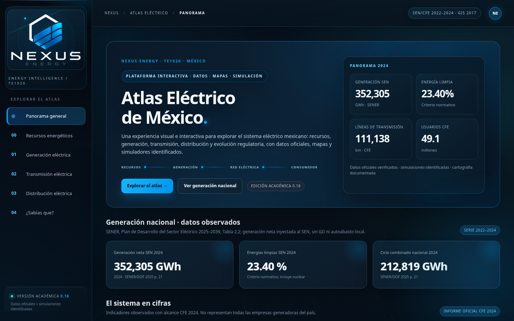
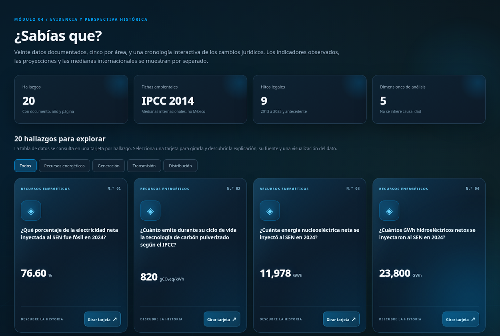

<p align="center">
  <a href="https://josetortas.github.io/atlas-electrico-mexico/">
    
  </a>
</p>

<h1 align="center">Atlas Eléctrico de México</h1>
<p align="center">
  <strong>De los recursos energéticos al consumidor.</strong><br />
  Una experiencia interactiva para explorar cómo se genera, transmite y distribuye la electricidad en México.
</p>

<p align="center">
  <a href="https://josetortas.github.io/atlas-electrico-mexico/"></a>
  
  
  
</p>

<p align="center">
  <a href="https://josetortas.github.io/atlas-electrico-mexico/"><strong>Explorar la plataforma</strong></a>
  &nbsp;·&nbsp;
  <a href="#-m%C3%B3dulos"><strong>Ver módulos</strong></a>
  &nbsp;·&nbsp;
  <a href="#-instalaci%C3%B3n-local"><strong>Ejecutar localmente</strong></a>
  &nbsp;·&nbsp;
  <a href="#-fuentes-y-rigor-de-los-datos"><strong>Consultar fuentes</strong></a>
</p>

---

## ⚡ El proyecto

**NEXUS ENERGY** es un atlas educativo y técnico desarrollado para la unidad **TE1020 · Análisis de Circuitos Eléctricos**. Reúne indicadores energéticos, cartografía interactiva, comparaciones entre tecnologías, simuladores de circuitos y contexto legislativo en una sola aplicación web.

No es una presentación estática: puedes **explorar mapas**, **filtrar datos**, **comparar tecnologías**, **probar parámetros eléctricos** y **descubrir cifras verificables** mediante tarjetas animadas.

### Vista previa

<a href="https://josetortas.github.io/atlas-electrico-mexico/">
  
</a>

<details>
<summary><strong>Ver la sección «¿Sabías que?» y las tarjetas interactivas</strong></summary>
<br />

<p>Las tarjetas se giran al seleccionarlas; el reverso reúne la explicación, la referencia documental y una visualización del dato.</p>
</details>

> **Nota visual:** las capturas corresponden a la familia visual 0.18; la versión actual del sitio es **0.18.3**, con mejoras de estabilidad durante el desplazamiento.

## 🧭 Módulos

| Módulo | Qué puedes explorar |
|:--|:--|
| **00 · Recursos energéticos** | Clasificador interactivo de recursos fósiles, nucleares y renovables; diagramas de conversión y comparación ambiental de tecnologías. |
| **01 · Generación eléctrica** | Series nacionales 2022–2024, participación por tecnología, catálogo de centrales y mapa con información geográfica histórica. |
| **02 · Transmisión eléctrica** | Sistemas eléctricos, ciudades sede regionales históricas, indicadores de infraestructura y simulador de pérdidas trifásicas. |
| **03 · Distribución eléctrica** | Indicadores de las 16 divisiones CFE, instalaciones georreferenciadas, cartografía institucional y simulador de transformador ideal. |
| **04 · ¿Sabías que?** | **20 hallazgos** (cinco por tema) en tarjetas 3D, gráficas explicativas y cronología de la reforma energética. |

### Lo que hace diferente al Atlas

- **Datos con contexto:** cada cifra se acompaña de institución, periodo, unidad y alcance cuando corresponde.
- **Mapas explorables:** Leaflet, capas de puntos documentados y límites estatales INEGI opcionales.
- **Aprendizaje activo:** clasificación, visualizaciones, preguntas interactivas y simulación de circuitos.
- **Diseño NEXUS ENERGY:** interfaz oscura, azul eléctrico, elementos animados, navegación fija y adaptación a móvil.
- **Transparencia metodológica:** distingue observaciones, cálculos, proyecciones y simulaciones.

## 🛠️ Tecnologías

<p>
  
  
  
  
  
</p>

**Arquitectura:** HTML, CSS y JavaScript modular sin backend ni compilación obligatoria. Los indicadores se organizan en archivos JSON; Leaflet presenta los mapas; GitHub Pages aloja el sitio estático. Algunas capas y tipografías requieren conexión a servicios externos.

## 🚀 Instalación local

La forma más rápida de conocerlo es abrir la **[demo pública](https://josetortas.github.io/atlas-electrico-mexico/)**. Para ejecutarlo en tu computadora:

```bash
git clone https://github.com/JoseTortas/atlas-electrico-mexico.git
cd atlas-electrico-mexico
python -m http.server 8000
```

Abre **http://localhost:8000** en el navegador. En Windows también puedes usar `py -m http.server 8000` si ese es tu comando de Python.

> **Importante:** no abras `index.html` directamente mediante `file://` para realizar las pruebas: los módulos JavaScript y los archivos JSON necesitan servirse por HTTP. **No es necesario ejecutar `npm`** para visualizar el sitio.

### Estructura del repositorio

```text
atlas-electrico-mexico/
├── index.html           # Entrada de la aplicación
├── assets/img/          # Identidad visual y mapa institucional
├── css/                 # Estilos, diseño, animaciones y Leaflet
├── js/                  # Módulos, gráficos, mapas y simuladores
├── data/                # Indicadores y catálogos en JSON
├── docs/                # Fuentes, auditorías y documentación
│   └── img/             # Capturas de este README
└── README.md
```

## 🗺️ Fuentes y rigor de los datos

El Atlas combina información de distintas instituciones y periodos. **No presenta todas las cifras como si pertenecieran al mismo año o universo.**

| Información | Referencia y alcance |
|:--|:--|
| **Generación nacional 2022–2024** | SENER, *Plan de Desarrollo del Sector Eléctrico 2025–2039*, tabla 2.2: energía neta inyectada al SEN. |
| **Infraestructura e indicadores CFE** | Informes Anuales de CFE; datos nacionales y operativos identificados por año. |
| **Centrales en el mapa** | CANIE/NACEI, inventario georreferenciado histórico **2017**; no equivale a un inventario vigente de 2024. |
| **Transmisión regional** | Referencias urbanas de sedes históricas CFE y estadísticas regionales de **2017**. |
| **Distribución regional** | Indicadores de las 16 divisiones CFE para **2022** e instalaciones documentadas geográficamente. |
| **Comparador ambiental** | IPCC AR5, anexo III, tabla A.III.2 (**2014**): referencias internacionales de emisiones por tecnología, no factores medidos en México. |
| **Reforma energética** | Legislación publicada en el DOF y documentos institucionales, distinguiendo antecedentes y marco posterior. |

**Documentación del proyecto:**

- [Fuentes y pendientes](docs/FUENTES_Y_PENDIENTES.md)
- [Serie nacional y auditoría](docs/SERIE_NACIONAL_Y_AUDITORIA_V013.md)
- [Catálogos georreferenciados](docs/CATALOGOS_GEOREFERENCIADOS.md)
- [Cartografía y cobertura GIS](docs/OPTIMIZACION_Y_COBERTURA_GIS_V016.md)
- [Auditoría de emisiones IPCC](docs/AUDITORIA_Y_EMISIONES_IPCC_V012.md)
- [Mejoras visuales de la versión 0.18](docs/MEJORAS_VISUALES_V018.md)

<details>
<summary><strong>Precisiones y limitaciones cartográficas</strong></summary>
<br />

- Los **límites estatales de INEGI** no son límites de las divisiones CFE ni de los sistemas eléctricos. La capa optimizada `data/inegi_estados_web.geojson` es opcional y puede incorporarse al repositorio cuando esté disponible.
- Las **ciudades sede** de transmisión son referencias urbanas, no coordenadas de subestaciones o trazados de líneas.
- Las instalaciones de distribución con coordenadas documentadas **no delimitan** el territorio de las 16 divisiones.
- El inventario CANIE/NACEI es **histórico (2017)**. No se mezclan automáticamente sus capacidades con las listas de centrales publicadas para años distintos.
- Los servicios cartográficos externos pueden estar temporalmente indisponibles, sin impedir el acceso al resto del Atlas.

</details>

## 🌐 Publicación en GitHub Pages

Este proyecto está organizado como sitio estático. Para desplegarlo en un repositorio propio:

1. Coloca `index.html` en la **raíz** de la rama `main`, junto con las carpetas del sitio.
2. Abre **Settings → Pages** en GitHub.
3. Selecciona **Deploy from a branch → main → /(root)** y guarda.
4. Visita la dirección generada por GitHub Pages.

Para conocer esta instancia, abre: **[josetortas.github.io/atlas-electrico-mexico](https://josetortas.github.io/atlas-electrico-mexico/)**.

---

<p align="center">
  <strong>NEXUS ENERGY</strong><br />
  <sub>Proyecto académico · TE1020 · Análisis de Circuitos Eléctricos</sub><br />
  <sub>El conocimiento energético se entiende mejor cuando los datos pueden explorarse.</sub>
</p>
